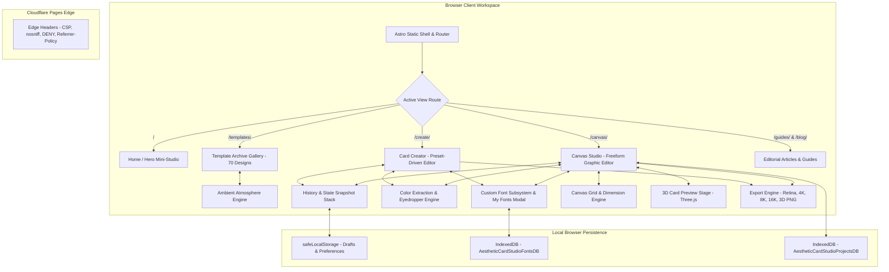
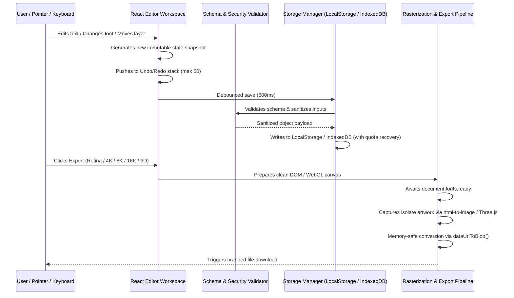

# ACG — System Architecture & Data Flow (`architecture.md`)

## 1. Overview & Architectural Philosophy

**Aesthetic Card Generator (ACG)** is a privacy-first, zero-backend creative tool for generating high-fidelity editorial cards, vintage passes, journal entries, and custom canvas artwork.
- **Zero-Backend Architecture**: All state computation, layer manipulation, color extraction, font rendering, and image rasterization happen 100% client-side in the user's browser.
- **Privacy Assurance**: No user content, imported photos, custom fonts, or quotes are ever transmitted to a remote server or telemetry service.
- **Framework & Runtime**:
  - **Static Site Generation (SSG)**: Built with **Astro 7.4.x** (`output: "static"`), producing 37 pre-rendered HTML routes with optimal SEO, OpenGraph tags, and semantic metadata.
  - **Client Workspaces**: Interactive editors are powered by **React 19** components hydrated on-demand with `client:only="react"` or `client:load`.
  - **Styling & Tokens**: **Tailwind CSS v4** utilizing semantic CSS custom properties defined in `src/index.css`.
  - **Edge Deployment**: Hosted globally on **Cloudflare Pages** with strict edge security headers.

---

## 2. Core Application Components

### 2.1 View Workspaces
1. **Homepage (`src/views/HomeView.tsx`)**:
   - Interactive hero mini-studio with real-time typography preview.
   - Quick export and seamless transfer to full editor via `sessionStorage`.
2. **Template Archive (`src/views/TemplatesView.tsx`)**:
   - 70 distinct editorial starting points categorised by style.
   - Live search, tag filtering, comparison tray, and scroll-reactive ambient lighting.
3. **Card Creator (`src/views/CreatorView.tsx` & `EditorView.tsx`)**:
   - Structured typography studio with curated presets (Editorial, Minimal, Technical, Poetic).
   - Real-time quote, author, tag, and finish customization with interactive 3D card tilt.
4. **Canvas Studio (`src/views/CanvasEditorView.tsx`)**:
   - Freeform vector canvas with infinite layout possibilities.
   - Layer manager (text, images, shapes, barcodes, QR codes, stamps, badges).
   - Precision alignment, rotation, z-indexing, clip masking, and natural-language quick command bar.

---

## 3. Data Flow & State Lifecycle

---

## 4. Trust Boundaries & Security Architecture

Because ACG accepts arbitrary user inputs, external images, uploaded fonts, and imported project JSON without a backend, the application enforces defense-in-depth across 5 key boundaries:

| Trust Boundary | Threat Vector | Mitigation Strategy | Implementation |
|---|---|---|---|
| **User Text & URL Parameters** | DOM XSS, CSS injection, script execution | React JSX escaping, strict color regex, string length bounds | `src/utils/richText.tsx`, `src/services/schemaValidator.ts` |
| **Project Import / JSON Deserialization** | Prototype pollution, corrupted objects, DOM freeze | Recursive `isPrototypePolluted` check, reviver JSON parsing, schema bounds (100–16384px, 500 layers max) | `src/services/schemaValidator.ts` |
| **File Upload (Images & SVGs)** | Malicious SVG scripts, disguised executables, decompression bombs | 10MB ceiling, binary magic byte checks, `sanitizeSvgMarkup` stripping `<script>`/`on*`, 16,384px dimension check | `src/services/imageSecurity.ts` |
| **Custom Font Uploads** | Malformed font binaries, parser exploits, memory exhaustion | 15MB limit, magic byte validation (`wOF2`, `wOFF`, `\x00\x01\x00\x00`, `OTTO`), isolated IndexedDB storage | `src/services/customFontManager.ts` |
| **Browser Storage & Exports** | Quota exhaustion, WebKit fetch limit, canvas tainting | `safeLocalStorageSet` with automatic stale key pruning, `dataUrlToBlob` sync decoder, actionable CORS/memory error reporting | `src/services/storageManager.ts`, `src/views/CanvasEditorView.tsx` |

---

## 5. Storage Architecture

1. **`localStorage`**:
   - `aesthetic_canvas_editor_draft_v2`: Active Canvas Studio document JSON.
   - `aesthetic_card_studio_draft_v1`: Active Card Creator document state.
   - `aesthetic_recycled_clips`: Saved element snippets for reuse across cards.
   - `acg_ambient_enabled`: Ambient atmosphere toggle preference (`true`/`false`).
   - `acg_theme_preference`: Theme preference (`dark` / `light` / `system`).
   - *Resilience*: Automatically evicts legacy drafts (`_v1`) if `QuotaExceededError` occurs.
2. **`sessionStorage`**:
   - `aesthetic_card_studio_hero_quote`: Ephemeral transfer payload from homepage mini-studio to full editor.
3. **`IndexedDB`**:
   - `AestheticCardStudioFontsDB`: Custom uploaded font binary storage (`fonts` store).
   - `AestheticCardStudioProjectsDB`: Local project library storage (`projects` store).

---

## 6. Export Pipeline Architecture

- **retina 2D exports (`png`, `jpeg`, `webp`)**: Captured via `html-to-image` at device pixel ratios 1x to 2x with `skipFonts: true` and explicit font readiness synchronization (`await document.fonts.ready`).
- **Ultra-HD exports (`4K`, `8K`, `16K`)**: Dynamically scaled using resolution clamping to preserve typography vector quality up to 15,360px.
- **3D Transparent Card Exports (`3d-4k`, `3d-8k`)**: Offscreen canvas captures rendered in **Three.js** using physical PVC clearcoat materials, subtle normal maps, and transparent alpha backgrounds.
- **Branded File Naming**: All downloaded files strictly follow the naming standard:
  `aestheticcardgenerator.com-[title]-[resolution]-[timestamp].[ext]`.
